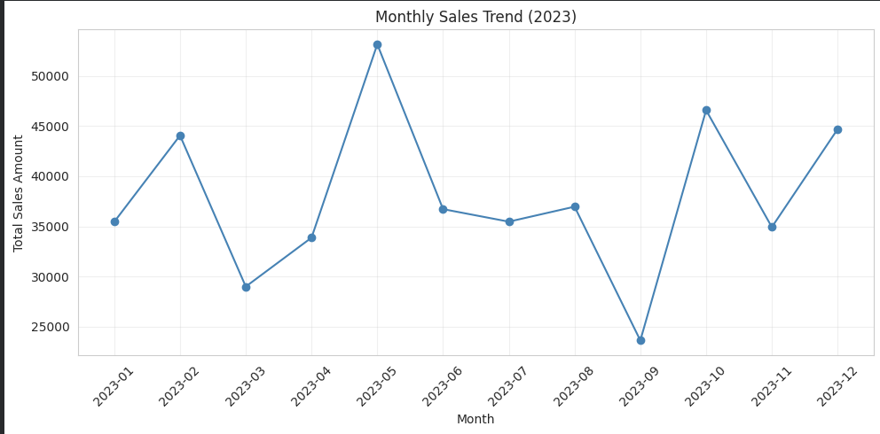
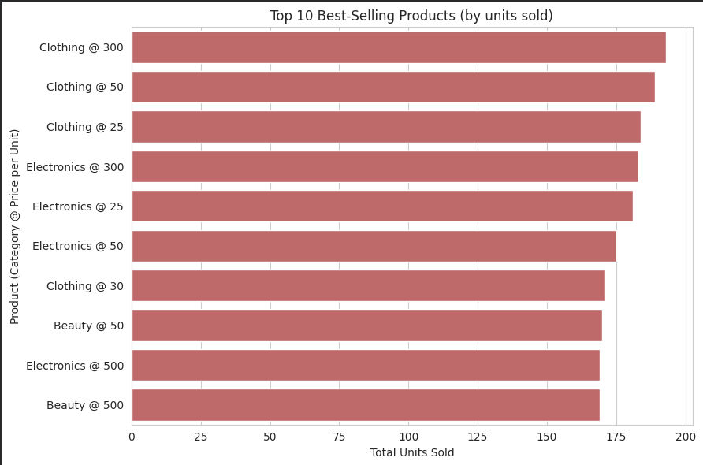
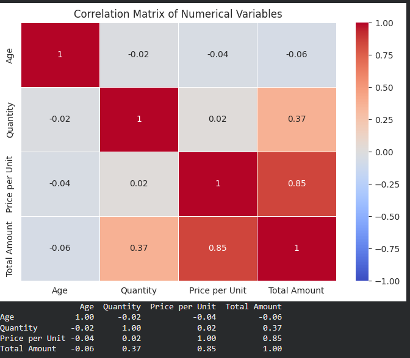
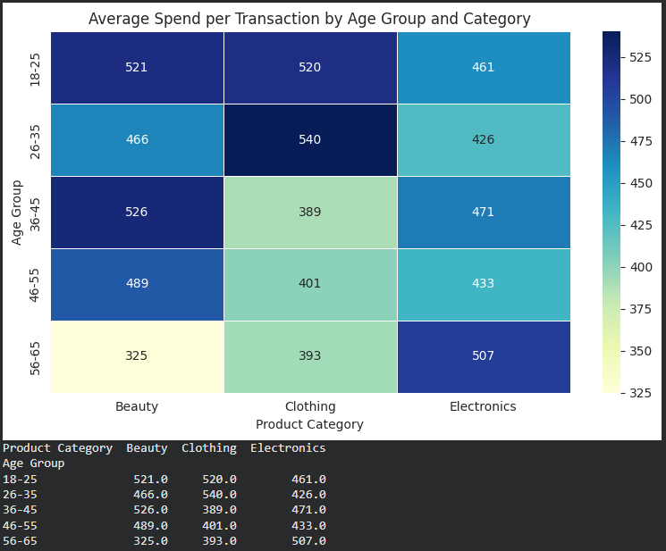

# EDA on Retail Sales Data

Exploratory Data Analysis of a retail sales dataset to find sales patterns, customer behaviour and business insights.

Oasis Infobyte Internship Program | Data Analytics | Level 1, Task 1

## Dataset

Retail Sales Dataset by Mohammad Talib, from Kaggle. It has 1,000 transactions and 9 columns: Transaction ID, Date, Customer ID, Gender, Age, Product Category, Quantity, Price per Unit and Total Amount. It has no missing values or duplicates. Every transaction is from a different customer.

The data covers 2023, plus one extra day (1 January 2024), which I left out of the monthly and quarterly charts.

## What I did

- Checked the shape, data types, null values and duplicates
- Calculated mean, median, mode and standard deviation for all numerical columns
- Plotted monthly and quarterly sales trends
- Looked at customers by age group and gender, and at revenue for each
- Compared product categories by revenue and units sold, and ranked the top 10 products
- Built a correlation heatmap
- Added a heatmap of average spend by age group and category
- Wrote observations after each chart and ended with business recommendations

## Key findings

- Total sales were 456,000 across 1,000 transactions.
- May was the best month (53,150) and September the worst (23,620). Q4 was the strongest quarter and Q3 the weakest.
- Electronics, Clothing and Beauty each bring in roughly a third of revenue, and men and women are almost evenly split.
- Price per unit has a strong link to the size of a sale (0.85). Age has almost none.
- Customers aged 56-65 spend the most per Electronics purchase (about 507) but the least per Beauty purchase (about 325).

## Screenshots

## Limitations

- The dataset has no real product names, so for the top 10 list I treated each category and price combination as one product.
- There is only one year of data, so I can't confirm whether the Q3 dip is seasonal.
- Each age and category group has only about 60-80 transactions, so the differences between them are patterns to check, not proven facts.

## Tools

Python, pandas, numpy, matplotlib, seaborn, Jupyter Notebook (Google Colab)

## How to run

1. Open `EDA_Retail_Sales.ipynb` in Google Colab or Jupyter Notebook.
2. Upload `retail_sales_dataset.csv` to the same location.
3. Run all cells from top to bottom.

## Author

[Your Full Name]
[Your LinkedIn profile link]
